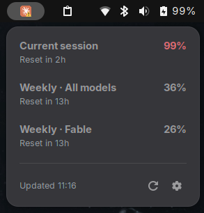
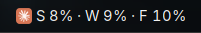
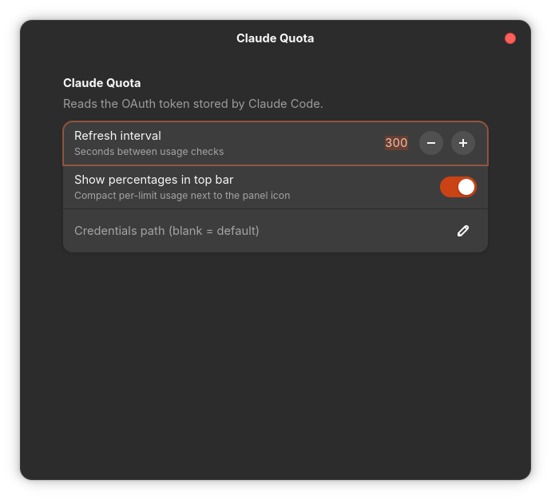

#  Claude Quota

Track your Claude Pro/Max usage from the GNOME top bar.


[](https://github.com/AndreaRicchi/gnome-shell-extension-claude-quota/actions/workflows/shexli.yml)
[](https://github.com/AndreaRicchi/gnome-shell-extension-claude-quota/releases/latest)
[](LICENSE)
[](https://github.com/AndreaRicchi/gnome-shell-extension-claude-quota/stargazers)
[](https://extensions.gnome.org/extension/10367/claude-quota/)
[](https://extensions.gnome.org/extension/10367/claude-quota/)

- A panel button shows the Claude icon plus your **current session** usage percentage.
- Clicking it opens a menu listing every active limit, session, weekly (all models), and per-model (e.g. Fable), each with its percentage and reset time.
- Optionally, compact per-limit percentages right in the top bar, enable **Show percentages in top bar** in the settings.
- Footer buttons: **Refresh** and **Settings**.





It reads the OAuth token that Claude Code already stores in
`~/.claude/.credentials.json` and calls the same `GET /api/oauth/usage`
endpoint that Claude Code's `/usage` command uses. Nothing is sent anywhere
except Anthropic's API.

> The token is only refreshed by Claude Code itself. If it expires, the panel
> shows a "Token expired" hint until you next use Claude Code.

## Requirements

- GNOME Shell 45–50
- libsoup 3 (ships with modern GNOME)
- An active Claude Pro/Max login in Claude Code

## Install

The recommended way is a one-click install from the
[GNOME Extensions website](https://extensions.gnome.org/), search for
[**Claude Quota**](https://extensions.gnome.org/extension/10367/claude-quota/)

## Settings



- **Refresh interval**: seconds between polls (default 300; also refreshes on menu open and manual refresh). On an HTTP 429 the interval backs off exponentially and resets on the next successful poll.
- **Show percentages in top bar**: compact per-limit percentages next to the panel icon (default off).
- **Credentials path**: override the default `~/.claude/.credentials.json`.

## Contributing

Clone, symlink, enable:

```sh
git clone https://github.com/AndreaRicchi/gnome-shell-extension-claude-quota.git
cd gnome-shell-extension-claude-quota
ln -s "$PWD" ~/.local/share/gnome-shell/extensions/claude-quota@andrearicchi.com
glib-compile-schemas schemas/
gnome-extensions enable claude-quota@andrearicchi.com
```

Reload the Shell to pick up changes (**X11:** <kbd>Alt</kbd>+<kbd>F2</kbd>, `r`,
<kbd>Enter</kbd>; **Wayland:** log out and back in), or exercise the extension in a
throwaway session with `dbus-run-session -- gnome-shell --devkit` (GNOME 50's
replacement for `--nested`).

Run the tests:

```sh
gjs -m test/usageModel-test.js   # pure logic (offline, uses captured fixture)
gjs -m test/live-fetch.js        # live end-to-end against your account
```
